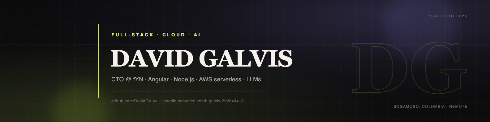

  

# Hola, soy David

Soy estudiante de Ingeniería de Sistemas y Computación en la UPTC (Colombia) y CTO de **fYN**, una app de finanzas personales con IA que funciona por WhatsApp, web y móvil. Me encargo de la arquitectura, el backend y el producto.

Trabajo principalmente con Angular, Node.js, TypeScript, AWS serverless y PostgreSQL. Busco prácticas profesionales o roles junior en full-stack, cloud o IA aplicada, con opción remota o híbrida.

Puedes ver mi portafolio en [davidgv-ux.github.io/david-galvis-portfolio](https://davidgv-ux.github.io/david-galvis-portfolio/).

## Proyectos

| Proyecto | Descripción | Stack |
|---|---|---|
| **[fYN](https://d133uvy2su9xyr.cloudfront.net)** | App de finanzas personales con IA por WhatsApp, web y móvil. En producción. | Angular, Node.js, AWS Lambda, Supabase, Groq |
| **[ReservaYa](https://github.com/DavidGV-ux/Front-ReservaYa)** | SaaS de reservas multi-tenant para barberías, spas y consultorios. Proyecto académico con 4 roles, OIDC e i18n. | Angular 21 SSR, Keycloak, MongoDB, AWS |
| **[Portafolio 3D](https://portafolio-murex-three-99.vercel.app)** | Portafolio 3D con fallback 2D y carga diferida. Reduje el JS inicial en un 83%. | Three.js, GSAP, Vite, TypeScript |
| **Voxy** | Coach de inglés por voz con Whisper, TTS y análisis de pronunciación. Repositorio privado. | Angular, Whisper, Groq, serverless |
| **[Vyon](https://github.com/DavidGV-ux/Vyon)** | Mockup navegable de gestión de proyectos estilo ClickUp. | React, Vite, TypeScript, Supabase |

El código de fYN y Voxy es privado. Puedo compartirlo y mostrar una demo en una entrevista.

## Stack

**Frontend:** Angular (17/21, SSR), React, React Native/Expo, TypeScript, Tailwind, Three.js.  
**Backend:** Node.js, Express, Python, Java, REST, serverless, JWT/OIDC.  
**Cloud y datos:** AWS (Lambda, API Gateway, S3, CloudFront, EventBridge), Supabase/PostgreSQL, MongoDB.  
**IA:** Groq/LLMs, prompt engineering, Whisper/STT, TTS, WhatsApp Cloud API.

## Algunos datos

- fYN funciona en 3 canales: WhatsApp, web y móvil.
- fYN tiene 10 automatizaciones programadas y más de 100 verificaciones automatizadas.
- Las respuestas de fYN tardan alrededor de 3–4 segundos.
- En el portafolio 3D, el JS inicial pasó de 716 kB a 121 kB (-83%).
- Promedio académico: 4.1/5.0; último semestre: 4.5/5.0.

## Contacto

- [Portafolio](https://davidgv-ux.github.io/david-galvis-portfolio/)
- [LinkedIn](https://www.linkedin.com/in/stiventh-galvis-2b2843413)
- [Email](mailto:davidstiventhgalvis@gmail.com)
- [GitHub](https://github.com/DavidGV-ux)
